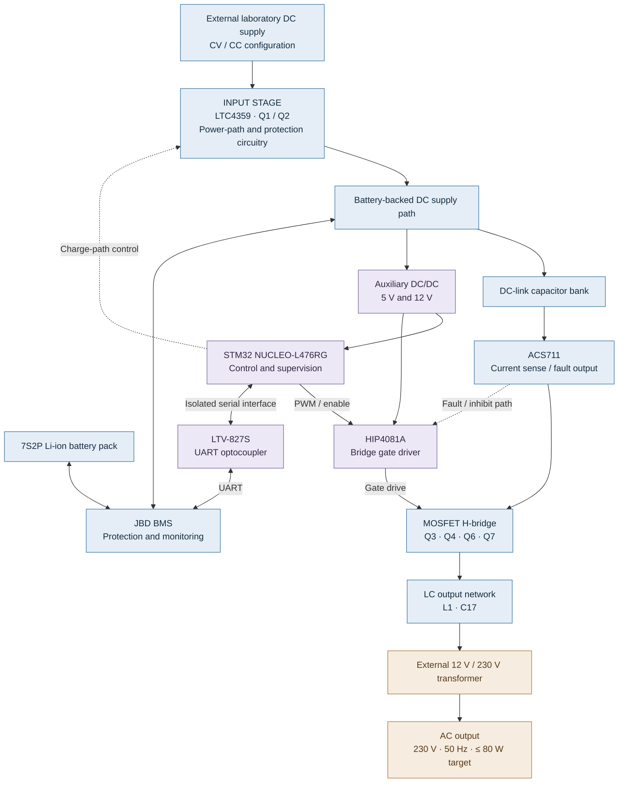
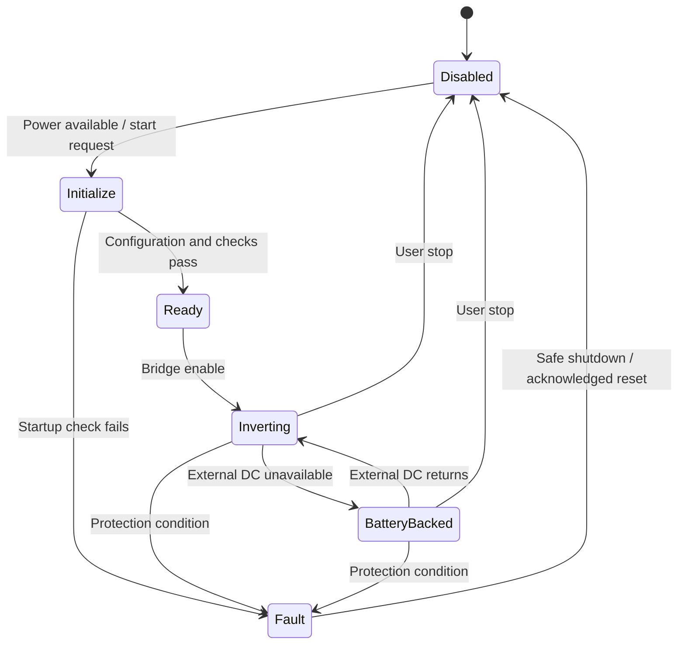

<div align="center">

# Embedded DC/AC UPS — Proof of Concept

### An STM32-controlled low-power inverter with Li-ion battery backup

**External laboratory DC supply · 7S2P Li-ion pack · 230 V AC / 50 Hz target · 80 W target**


**Hardware design · Embedded firmware · Power electronics · Battery management**

</div>

> [!IMPORTANT]
> **Engineering proof of concept — not a certified UPS, commercial inverter, or general-purpose 230 V laboratory power source.** The specifications below describe **design targets**, not verified performance. Hardware, firmware, protection behavior, and output quality must be validated before any energized use.

---

## Overview

**Embedded-DCAC-UPS-PoC** is an engineering project exploring a **microcontroller-controlled DC-to-AC inverter with battery-backed power continuity**.

The system is designed to accept power from an **external laboratory DC power supply with adjustable constant-voltage/constant-current (CV/CC) limits** and to interface with an external **7S2P lithium-ion battery pack** protected by a **JBD battery management system (BMS)**. Its inverter stage is intended to generate **230 V AC at 50 Hz, up to 80 W**, using an H-bridge, an LC output network, and a step-up transformer.

An **STM32L476RG** development board provides the control platform. Dedicated circuitry handles the input power path, MOSFET gate driving, current sensing, auxiliary rails, and an optically isolated communication interface to the BMS.

The purpose is to **design, integrate, and experimentally evaluate the architecture**—including its limitations—not to present an off-the-shelf UPS or a substitute for a calibrated AC power source.

### At a glance

| Property | Design intent / implementation |
|:--|:--|
| **Project class** | Embedded power-electronics **proof of concept** |
| **Primary input** | External adjustable **DC laboratory power supply**, operated with external CV/CC limits |
| **Backup energy** | External **7S2P Li-ion battery pack**, with **JBD BMS** |
| **Target AC output** | **230 V RMS**, **50 Hz**, **up to 80 W** |
| **Inverter architecture** | N-channel MOSFET **H-bridge**, LC network, external step-up transformer |
| **PWM / control** | STM32-generated complementary PWM; **20 kHz switching target** |
| **Controller** | **STM32 NUCLEO-L476RG** |
| **Gate driver** | **HIP4081A** full-bridge driver |
| **Current monitoring** | **ACS711** Hall-effect current sensor and associated fault circuitry |
| **BMS communication** | JBD UART via dual-channel **LTV-827S** optocoupler |
| **Auxiliary power** | TRACO **5 V** and **12 V** DC/DC modules |
| **Hardware CAD** | **Altium Designer**; schematic sections: Input, Control, Output |
| **PCB design target** | Two-layer FR-4, approximately **1.6 mm**, **2 oz copper** per layer |
| **Maturity** | Experimental design; **not production-ready or fully validated** |

---

## System architecture



*Functional diagram, intentionally simplified. It does not represent the complete schematic, connector pinout, protective-earth arrangement, or validated current-sharing behavior.*

### Functional separation

| Subsystem | Responsibility | Schematic |
|:--|:--|:--|
| **Input Stage** | External DC input, MOSFET-controlled input path, surge and gate protection | `Input_Stage.SchDoc` |
| **Control Stage** | STM32 connections, command signals, JBD UART isolation, external user switch | `Control_Stage.SchDoc` |
| **Output Stage** | DC-link energy storage, current sensing, H-bridge, gate driver, output filter, auxiliary supplies | `Output_Stage.SchDoc` |
| **External assemblies** | 7S2P pack, JBD BMS, DC bench supply, transformer, AC fuse and outlet, enclosure | Integrated outside the three PCB schematic sheets |

---

## How the system is intended to work

### 1. External DC source available

A laboratory DC source provides input power with its **voltage and current limits configured externally**. The input circuitry uses the **LTC4359** and a pair of power MOSFETs to manage the input conduction path. The shared system architecture is intended to support the inverter while interacting with the protected battery pack.

**Important distinction:** The LTC4359 is an **ideal-diode controller**, not an integrated Li-ion charger. Battery charging depends on the **external supply's CV/CC configuration**, the actual wiring, and BMS protection. The BMS must not be mistaken for a charging regulator.

### 2. Loss of external DC input

The battery-backed DC path is intended to maintain power to the inverter when the external DC source is removed or becomes unavailable. The AC output is produced by the **same inverter stage** in both situations.

This is a **DC-input battery-backup inverter architecture**, not a conventional mains-input, double-conversion online UPS. Whether the transition is genuinely uninterrupted must be demonstrated by measurement; it is **not yet a verified feature**.

### 3. DC-to-AC conversion

The STM32 is intended to generate complementary PWM control signals, including appropriate dead time. The HIP4081A drives four MOSFETs arranged as an H-bridge. The resulting switched waveform passes through an **LC network** and then an **external step-up transformer**.

The goal is a 50 Hz AC output with a nominal 230 V RMS level. **There is no closed-loop feedback of the 230 V output voltage in the present schematics**, so voltage regulation, waveform distortion, and performance with changing battery voltage or load are subjects for testing rather than guaranteed specifications.

### 4. Monitoring and shutdown behavior

The ACS711 measures current in the DC power path. Its fault signal is associated with a **discrete-transistor inhibit path** to the HIP4081A. The STM32 provides further control signals and is intended to supervise operating states and information reported by the BMS.

Fault thresholds, fault polarity, response time, startup sequencing, and successful shutdown under actual conditions still require hardware and firmware validation.

---

## Hardware design

### Input Stage — controlled DC input

The input schematic contains the components used to interface the external laboratory supply with the battery-related DC circuitry.

| Reference | Component | Role |
|:--|:--|:--|
| **U1** | Analog Devices **LTC4359** | Ideal-diode / reverse-current control |
| **Q1, Q2** | **IPB031N08N5ATMA1** N-channel MOSFETs | Controlled input conduction path |
| **D2** | **BZX85C12** | Gate-to-source voltage clamping |
| **D3, D4** | **SMCJ33A**, **SMAJ24A** | Transient-voltage protection |
| **F1** | PCB-mounted fuse-holder footprint | Input fuse position; actual installed fuse rating requires selection |
| **J1, J2** | Terminal blocks | External DC and battery-side connections |

The circuitry includes the **`CHG_CTRL`** control signal. Although the stage interfaces with the battery supply, it **does not independently implement a complete CC/CV charging algorithm**.

### Control Stage — STM32 and BMS interface

The controller is an **STM32 NUCLEO-L476RG**, connected through a custom dual-Morpho header arrangement. It provides the planned firmware-controlled behavior rather than a dedicated custom STM32 PCB.

Main control interfaces include:

- **Four complementary PWM-related control signals** for the two H-bridge legs.
- **`BRIDGE_EN`** for bridge operation control.
- **`CHG_CTRL`** for the input-stage control path.
- **`USART3_TX` / `USART3_RX`** for BMS communication through an optocoupler.
- An external **bistable ON/OFF switch** connected through `J7`.
- Auxiliary power from the 5 V supply; the NUCLEO provides the board's 3.3 V logic rail as configured.

#### BMS communication isolation

The design uses an **LTV-827S-TA1 dual-channel optocoupler** (`Q8`) between the STM32 and the JBD UART connector (`J5`). This separation is intentional because **the BMS-side UART reference is not the same node as the protected system negative (`BAT_OUT-`)**.

The receive-side optocoupler **inverts the UART logic**, and the schematic explicitly notes that **USART3 RX inversion (`RXINV`) must be enabled in firmware**. Baud-rate compatibility, signal margins, and reliable bidirectional communication remain to be verified on the actual hardware.

> [!CAUTION]
> Do not short **`JBD_GND`** to **`BAT_OUT-`** to make UART communication work. The BMS-side and controller-side grounds are intentionally separated. Also, the fourth position on the investigated JBD communication connector was observed at battery-positive potential despite being treated as **NC**; **leave it unconnected** and verify the exact BMS connector variant before assembly. The optocoupler's component isolation rating is **not** proof that the assembled PCB meets a particular safety-isolation standard.

### Output Stage — inverter and auxiliary supplies

| Reference | Component | Role |
|:--|:--|:--|
| **U5** | **HIP4081AIPZ** | High-side/low-side full-bridge MOSFET driver |
| **Q3, Q4, Q6, Q7** | **IPB031N08N5ATMA1** | Four switches of the H-bridge |
| **U2** | **ACS711ELCTR-12AB-T** | Hall-effect DC-link current sensing and fault signaling |
| **Q5** | **PZT3904T1G** | Discrete transistor used in the bridge inhibit-control circuitry |
| **C4–C11** | Eight **680 µF** electrolytic capacitors | Bulk DC-link capacitance |
| **C12–C15** | Local ceramic capacitors | High-frequency bridge decoupling |
| **D5/C16, D6/C18** | Bootstrap components | Floating high-side gate-drive supplies |
| **L1** | **Bourns 1140-101K-RC** | Output filter inductor |
| **C17** | **KEMET PHE426HR8100JR06L2** | Output filter capacitor; final filter performance pending validation |
| **U3** | **TRACO TSR 1-4850WI** | 5 V auxiliary DC/DC supply |
| **U4** | **TRACO TSR 1-48120WI** | 12 V gate-driver supply |
| **F2** | PCB-mounted fuse-holder footprint | DC-side fuse position; final fuse selection requires validation |
| **J4** | Terminal block | Connection to the **low-voltage side of the external transformer** |

The **230 V AC output is downstream of the external transformer**, not a 230 V trace routed from the `J4` PCB terminals. An external AC-side fuse, outlet, suitable wiring, and a protective enclosure are part of the intended assembly and must be designed and reviewed separately.

---

## Power, control, and communication domains

The distinction between these domains is important for both PCB layout and testing.

| Domain | Example nets / connections | Design consideration |
|:--|:--|:--|
| **DC input** | `VIN+`, `VIN-`, `BAT_IN+` | Controlled conduction, transient protection, externally limited supply |
| **Protected battery / DC bus** | `BAT_OUT+`, `BAT_OUT-` | BMS-controlled battery connections and high-current routing |
| **Bridge power** | `SW_A`, `SW_B`, H-bridge DC-link nets | Compact high-current commutation loops; careful copper geometry |
| **Gate drive** | `Q_AHO`, `Q_ALO`, `Q_BHO`, `Q_BLO` | Short routes, gate resistors, bootstrap loops, dead time |
| **Logic and auxiliary** | `3V3_STM32`, `5V_STM32`, `12V_DRIVER` | Decoupling and correctly configured NUCLEO power input |
| **STM32 ↔ BMS UART** | `USART3_TX`, `USART3_RX`, `JBD_RXD`, `JBD_TXD` | Optocoupled interface and firmware RX inversion |
| **BMS-side reference** | `JBD_GND` | Keep isolated from the protected system negative |
| **External AC** | Transformer secondary and panel output | Hazardous voltage, external fuse, insulation and enclosure |

### Main external interfaces

| Connector | Schematic | Function |
|:--|:--|:--|
| **J1** | Input | External laboratory DC input |
| **J2** | Input | Battery-related connection from the input stage |
| **J3** | Output | Protected battery/DC supply connection to the inverter |
| **J4** | Output | External transformer low-voltage winding connection |
| **J5** | Control | JBD BMS communication connector |
| **J6** | Control | NUCLEO-L476RG Morpho interface |
| **J7** | Control | External bistable ON/OFF switch |

> **Connector identification is not a wiring guide.** Use the current Altium schematic, the BMS documentation, and a verified harness pinout before connecting a battery or energizing the assembly.

---

## Embedded control concept

The firmware is intended to coordinate generation, supervision, and protection. The diagram below shows the **planned operating logic**, not a claim that every transition has already been implemented or tested.



### Planned firmware responsibilities

| Area | Planned behavior |
|:--|:--|
| **Waveform generation** | Timer-driven, complementary PWM for the H-bridge; 50 Hz reference |
| **Gate-drive safety** | Dead-time configuration, controlled enable/disable, startup interlocks |
| **Battery monitoring** | JBD UART communication and interpretation of BMS-reported values |
| **User interaction** | ON/OFF control through the external bistable switch |
| **Fault handling** | Respond to hardware fault indication and relevant BMS conditions |
| **Supervision** | Distinguish external-input operation from battery-backed operation |

**Not presently implemented in the hardware:** closed-loop measurement and regulation of the transformer's **230 V RMS output**. Consequently, this PoC must not be represented as a precision or regulated AC source.

---

## Design scope and limitations

### What this PoC is intended to demonstrate

- Integration of **power electronics and embedded control** in one functional architecture.
- Generation of a low-power **50 Hz AC output** from a DC energy source.
- Interaction between an **externally CV/CC-limited DC input** and a protected Li-ion battery system.
- Feasibility of **battery-backed continuity** when the external DC input disappears.
- Use of **current monitoring, gate-driver inhibition, and BMS telemetry** as part of the control and protection strategy.
- Practical PCB design challenges involving **high current, switching nodes, isolation boundaries, and thermal layout**.

### What the project does **not** claim

| Not claimed | Explanation |
|:--|:--|
| **Certified UPS functionality** | No UPS standard compliance or verified interruption time is claimed. |
| **Regulated 230 V under every condition** | Output-voltage feedback is absent in the present hardware. |
| **Pure sine wave of verified quality** | RMS voltage, harmonics, distortion, and behavior under load require measurement. |
| **Universal 230 V test equipment** | The unit does not reproduce all characteristics of a utility mains supply or programmable AC source. |
| **Integrated battery charging control** | The external laboratory supply provides the required CV/CC limitation. |
| **Mains-connected online double-conversion UPS** | There is no AC mains input stage; the primary input is DC. |
| **Continuous-duty / production readiness** | Thermal performance, reliability, isolation, enclosure, and protection must be validated. |

---

## Verification plan

The project's most valuable results will come from **measurements and documented limitations**, not from the nominal component ratings alone.

| Test group | Intended evidence | Status |
|:--|:--|:--|
| **Schematic review** | Connectivity, pin mapping, functional consistency | Design review in progress |
| **PCB checks** | DRC, clearance, copper bottlenecks, isolation boundaries, thermal paths | Pending final layout |
| **Auxiliary rails** | 5 V, 12 V, and STM32 supply behavior | Not documented as validated |
| **Control signals** | PWM timing, dead time, gate-driver enable/disable | Not documented as validated |
| **BMS interface** | UART decoding, optocoupler operation, correct reference domains | Not documented as validated |
| **Low-voltage power stage** | Controlled startup and bridge switching behavior | Not documented as validated |
| **AC output** | Output RMS voltage, 50 Hz frequency, waveform quality | Not documented as validated |
| **Load response** | Operation over a defined range of suitable low-power loads | Not documented as validated |
| **Battery transition** | Behavior when the external DC supply becomes unavailable | Not documented as validated |
| **Fault response** | Current-fault inhibition and controlled shutdown | Not documented as validated |
| **Thermal behavior** | MOSFET, transformer, filter, and connector temperatures | Not documented as validated |

The status descriptions deliberately avoid implying tests have passed when no corresponding measurements have been published.

### Development milestones

- [x] Divide the concept into **Input**, **Control**, and **Output** schematic sheets.
- [x] Select the main controller, driver, power switches, BMS interface, and auxiliary supplies.
- [ ] Complete PCB placement and routing, including high-current and isolation reviews.
- [ ] Complete electrical rule checking and manufacturing review.
- [ ] Develop and validate STM32 firmware.
- [ ] Verify power-up, gate timing, BMS communications, and protective behavior.
- [ ] Characterize AC output and load response with suitable instrumentation.
- [ ] Verify intended battery-backup behavior and document transfer characteristics.
- [ ] Publish measurement results, schematics, PCB views, and limitations.

---

## Safety and intended use

> [!CAUTION]
> **Dangerous voltage and high-energy battery system.** This design combines a Li-ion pack capable of high fault current with circuitry intended to generate **230 V AC**, which can cause electric shock, fire, equipment damage, or serious injury. It is **not suitable for unattended operation, direct connection to building wiring, or use as an approved power supply for safety-critical loads**.

Key boundaries for development and documentation:

1. **External CV/CC control is essential.** Never assume that the LTC4359 or BMS alone regulates Li-ion charging; set the laboratory supply according to the actual cells' permitted voltage and current limits.
2. **The BMS does not replace a source-side battery fuse.** The pack, wiring, connectors, and PCB require a coordinated protection strategy.
3. **Preserve the BMS communication isolation boundary.** `JBD_GND` and the protected system ground are not interchangeable.
4. **A transformer is not a complete safety assessment.** Verify its insulation rating, secondary wiring, creepage/clearance, enclosure, protection, and earthing arrangement.
5. **Use appropriate high-voltage measurement methods.** Never connect a grounded oscilloscope probe clip to an arbitrary floating or mains-potential node. Qualified differential/isolated measurement equipment and appropriate procedures are required.
6. **Do not deliberately short a Li-ion pack to test protection.** Fault verification requires controlled, purpose-designed methods.
7. **Do not assume the output is regulated or mains-equivalent.** Connect only suitable test loads after the electrical design and protection paths have been reviewed.

This repository documents **an experimental engineering design**, not assembly or operating instructions for a finished consumer product.

---

## Design files and documentation

The Altium design is separated into three source schematic documents:

| File | Contents |
|:--|:--|
| `Input_Stage.SchDoc` | DC input, LTC4359, MOSFET input path and protective devices |
| `Control_Stage.SchDoc` | NUCLEO header, BMS UART isolation and external controls |
| `Output_Stage.SchDoc` | H-bridge, HIP4081A, ACS711, capacitors, filter and DC/DC supplies |

PCB documents, manufacturing outputs, firmware, test data, and photographs should be added to the repository as each milestone is completed. **The presence of a schematic does not mean that hardware or firmware has passed validation.**

### Suggested repository organization

The following is a **proposed structure**, not a claim that these directories already exist:

```text
Embedded-DCAC-UPS-PoC/
├── README.md
├── hardware/
│   ├── schematics/
│   ├── pcb/
│   └── manufacturing/
├── firmware/
├── docs/
│   ├── architecture/
│   └── safety/
├── tests/
│   ├── measurements/
│   └── waveforms/
└── media/
    ├── pcb-renders/
    └── prototype-photos/
```

---

## Why this project exists

This PoC brings together several disciplines typically handled separately: **embedded programming, analog and digital interfaces, MOSFET gate driving, switched power conversion, battery protection, PCB engineering, and experimental verification**.

Its value lies in answering concrete engineering questions: Does the chosen architecture behave as expected? Can the power stage be controlled safely? How does the output respond to input and load changes? Does the battery-backed path preserve operation when external DC power disappears? Which design assumptions survive real measurements?

**A useful proof of concept is not one that claims perfection; it is one that makes its design decisions, results, and limitations reproducible and clear.**

---

<div align="center">

**Embedded-DCAC-UPS-PoC**  
*An engineering demonstrator for embedded DC/AC conversion and Li-ion battery-backed power.*

**Designed for investigation and validation — not certified for general-purpose use.**

</div>
